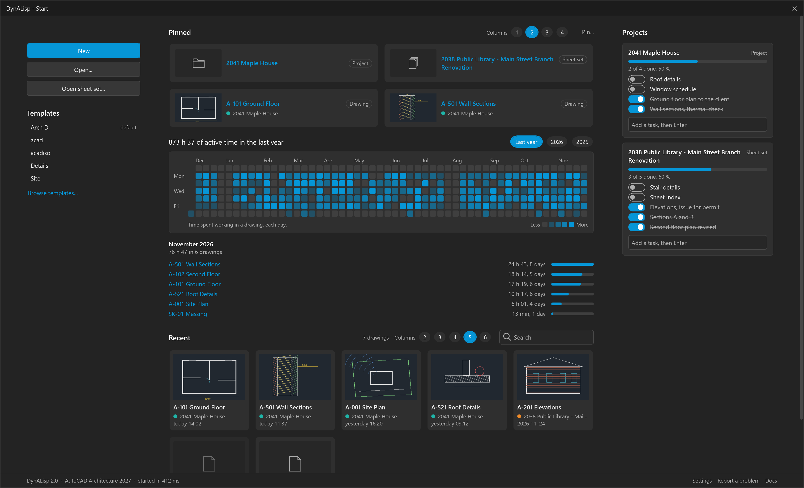
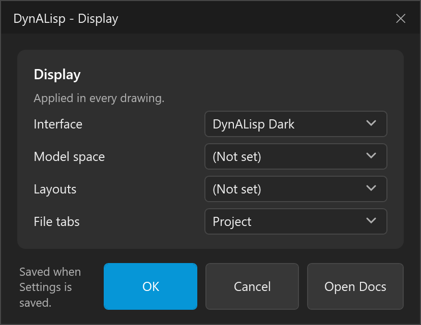
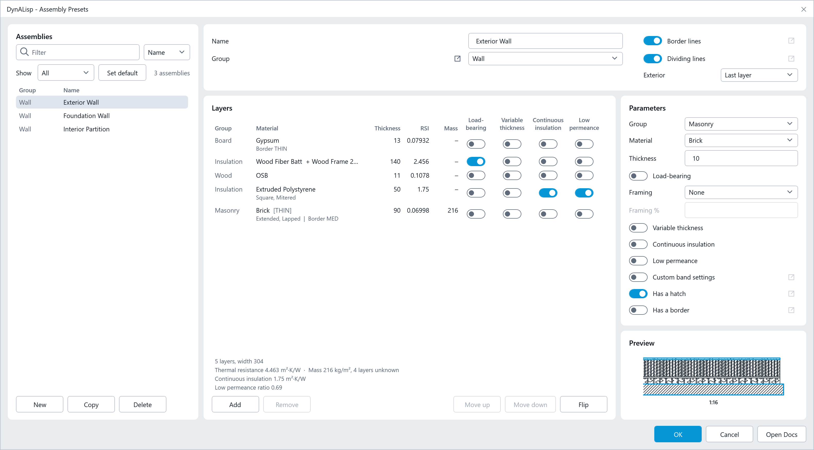
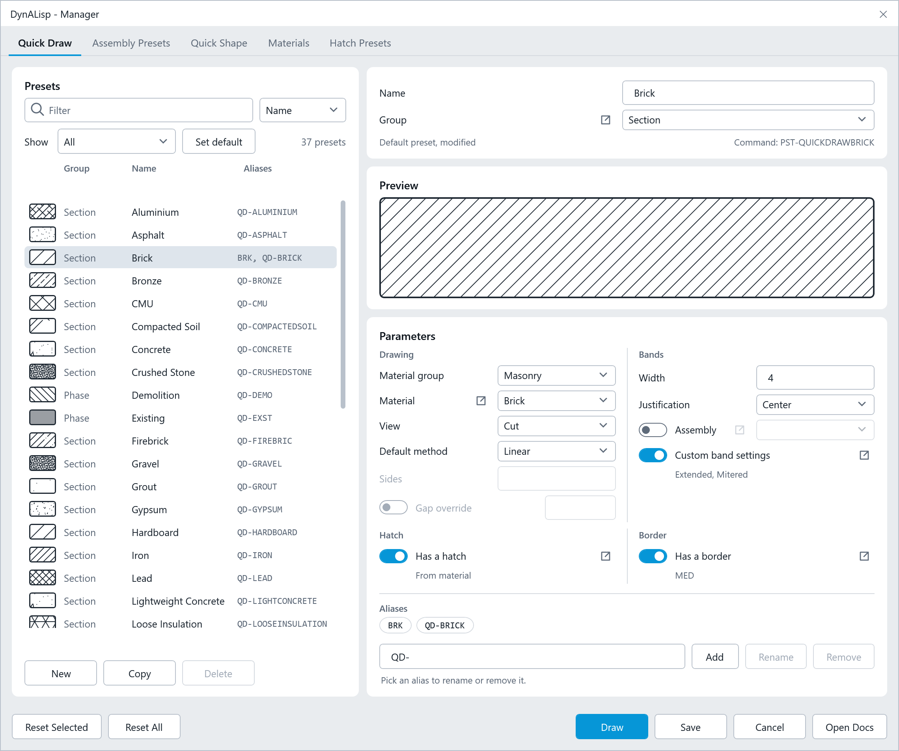
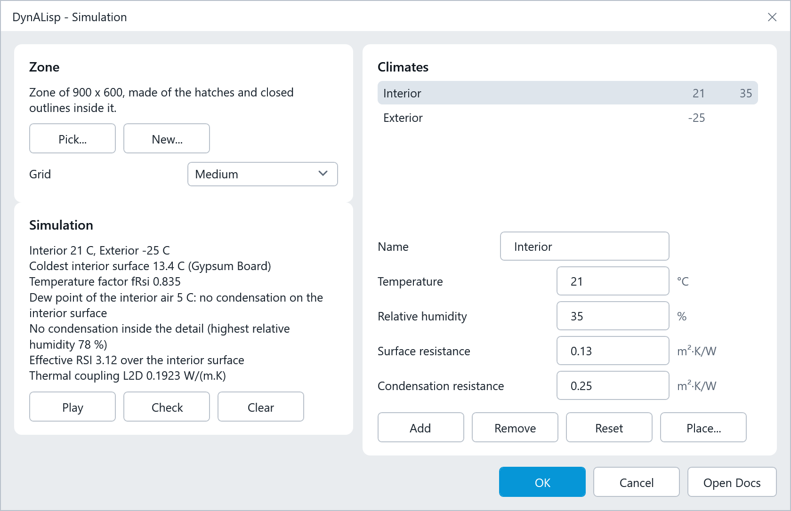
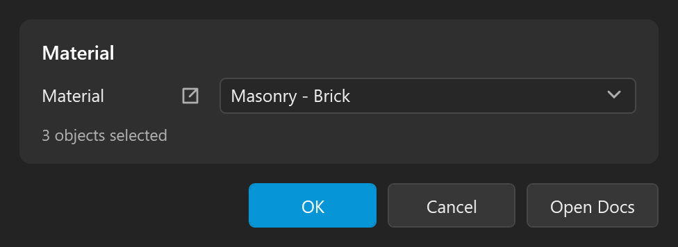
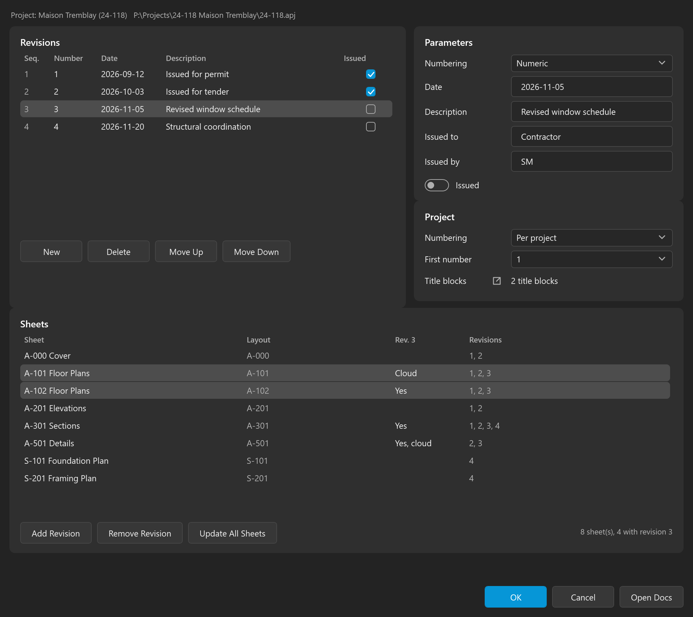
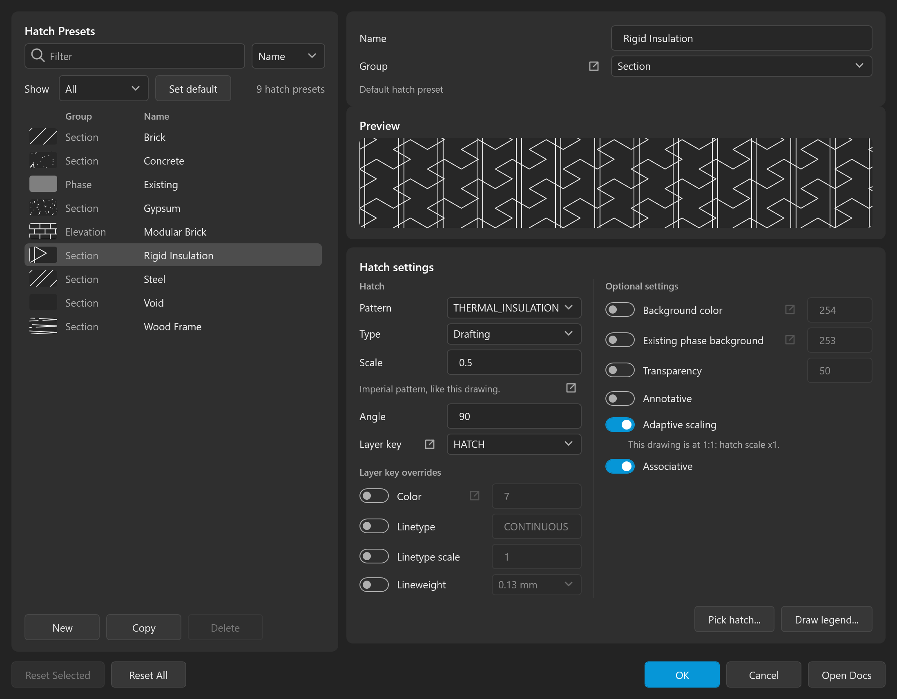
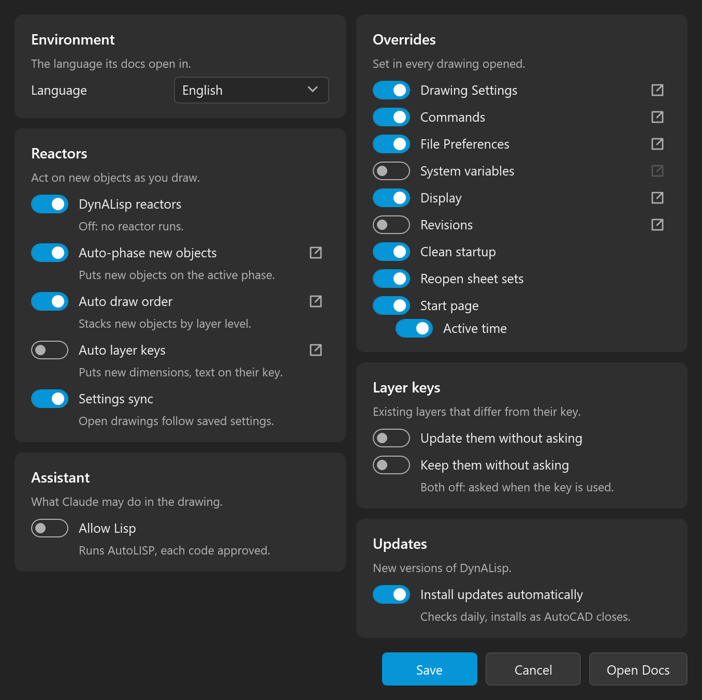

# Nouveautés

Ce que chaque version de DynALisp apporte à ceux qui dessinent avec lui, la plus
récente d'abord : la copie française de CHANGELOG.md (son format y est décrit), montrée
par la fenêtre What's New quand DynALisp est en français (Dyl-Settings > Environment >
Language). Mêmes versions, mêmes changements, mêmes images et liens ; une version qui
n'y est pas encore est montrée en anglais. En UTF-8.

## 2.1 - 2026-11-27

### Une page Début bien à vous
Dyl-Settings > Overrides > Start page affiche la page de DynALisp dans l'onglet Début : New, Open et vos gabarits à gauche ; vos dessins, jeux de feuilles et projets épinglés, le temps passé dans chaque dessin jour par jour et vos dessins récents au centre ; les tâches de chaque projet à droite. Cliquez sur un dessin pour voir ses jours, double-cliquez pour l'ouvrir. Un clic droit sur un dessin lui donne l'image de votre choix, ou une zone du dessin refaite à chaque enregistrement. Report a problem ouvre un ticket où le diagnostic est déjà joint.

[Ouvrir la documentation](Contents/Modules/Dynalisp/Docs/Core/Dyl-StartPage.htm)

### Interface sombre aux couleurs de DynALisp
Dyl-Settings > Display > Interface colore tout AutoCAD, dans son thème sombre, comme les fenêtres de DynALisp : le ruban, les palettes, Propriétés, la barre d'état, les onglets de fichiers, la barre de titre et l'onglet Début. DynALisp Neutral fait de même dans un gris neutre, plus foncé. L'espace objet, le papier des présentations et le fond autour suivent, ou gardent une couleur à eux. Une expérience qu'Autodesk ne prend pas en charge.

[Ouvrir la documentation](Contents/Modules/Dynalisp/Docs/Core/Dyl-Settings.htm#display)

### Une couleur par projet sur les onglets de fichiers
Dyl-Settings > Display > File tabs met une fine barre de couleur sur l'onglet de chaque dessin, la même pour tous les dessins d'un projet (le projet du Project Navigator, ou le jeu de feuilles) : les dessins de chaque projet se repèrent d'un coup d'œil.
[Ouvrir la documentation](Contents/Modules/Dynalisp/Docs/Core/Dyl-Settings.htm#display)

### Vos jeux de feuilles rouverts à chaque démarrage
AutoCAD oublie les jeux de feuilles du Gestionnaire du jeu de feuilles quand il se ferme. Avec Reopen sheet sets activé (Dyl-Settings > Overrides), DynALisp les rouvre à chaque démarrage d'AutoCAD, jusqu'à ce que vous les fermiez dans le gestionnaire.
[Ouvrir la documentation](Contents/Modules/Dynalisp/Docs/Plugins/SheetSets.htm)

### Les assemblages du code listés une fois, avec leurs variantes
Dans la fenêtre Assembly Presets, les assemblages qui ne diffèrent que par leurs panneaux, leur isolant ou leur espacement sont listés une fois (B6), et leurs variantes (B6a à B6e) se choisissent dans la liste Variant de la boîte Layers.

[Ouvrir la documentation](Contents/Modules/Dynalisp/Docs/Draw/Dyl-AssemblyPresets.htm)

### Un Manager plus rapide
Les onglets du Manager s'ouvrent en une demi-seconde environ, Assembly Presets compris, et ne clignotent plus quand vous changez d'onglet.
[Ouvrir la documentation](Contents/Modules/Dynalisp/Docs/Draw/Dyl-Manager.htm)

### Enregistrer un bogue intermittent
DIAG-RECORD enregistre en arrière-plan ce que font AutoCAD et DynALisp, pour un bogue trop rare pour être pris d'un coup (un zoom qui saute, un panoramique qui reste bloqué). Une pastille rouge REC montre qu'il est actif : cliquez Bogue maintenant chaque fois que vous le sentez, puis Arrêter, et le fichier de l'enregistrement s'ouvre, prêt à joindre à un rapport.
[Ouvrir la documentation](Contents/Modules/Dynalisp/Docs/Troubleshooting/Dyl-Diagnostics.htm#sending)

### Des nouveautés pour vous
Cette fenêtre montre maintenant ce que chaque version vous apporte, avec des images et un lien vers la documentation de chaque changement.
[Ouvrir la documentation](Contents/Modules/Dynalisp/Docs/Core/Dyl-Info.htm#updates)

## 2.0 - 2026-11-25

### DynALisp 2.0 pour AutoCAD 2025 et plus récent
DynALisp 2.0 fonctionne dans AutoCAD 2025, 2026 et 2027. Pour AutoCAD 2015 à 2024, gardez DynALisp 1.2 : il reçoit encore des correctifs, et son programme d'installation est sur la page des versions. Le programme d'installation de 2.0 le dit quand il ne trouve pas d'AutoCAD 2025 ou plus récent.
[Ouvrir la documentation](Contents/Modules/Dynalisp/Docs/Core/Dyl-Info.htm#updates)

## 1.2 - 2026-11-25

### Le Manager : toutes les fenêtres de préréglages en une
Quick Draw, Assembly Presets, Quick Shape, Materials et Hatch Presets sont les onglets d'une seule fenêtre : passez d'un préréglage à son assemblage, à son matériau et à sa hachure d'un clic. Elle reste ouverte pendant que vous dessinez.

[Ouvrir la documentation](Contents/Modules/Dynalisp/Docs/Draw/Dyl-Manager.htm)

### Simulation d'un détail 2D
Dyl-Simulation calcule le flux de chaleur, la vapeur, le risque de condensation et le bilan d'humidité mensuel d'un détail dessiné avec des matériaux, selon les méthodes des normes ISO 10211, 6946 et 13788.

[Ouvrir la documentation](Contents/Modules/Dynalisp/Docs/Analysis/Dyl-Simulation.htm)

### Posez vos questions à Claude sur le dessin
L'assistant (Dyl-Assistant) répond aux questions sur le dessin et le modifie une fois que vous avez approuvé. Text Fix corrige les textes d'un dessin avec Claude Code. Désactivé tant que vous ne l'activez pas.
[Ouvrir la documentation](Contents/Modules/Dynalisp/Docs/Utilities/Dyl-Assistant.htm)

### Des matériaux sur vos objets
Donnez un matériau aux objets que vous dessinez, copiez-le d'un objet à un autre et voyez de quoi chaque objet est fait. Les assemblages du code du bâtiment viennent avec leur résistance au feu et leur indice de transmission du son.

[Ouvrir la documentation](Contents/Modules/Dynalisp/Docs/Draw/Dyl-MaterialAssign.htm)

### Des fenêtres à la taille de votre écran
Chaque fenêtre de DynALisp tient dans l'écran, se redimensionne et s'ouvre de nouveau là où vous l'avez laissée. La fenêtre Hatch Presets est nouvelle, ses aperçus Drafting toujours à 1:1.
[Ouvrir la documentation](Contents/Modules/Dynalisp/Docs/Draw/Dyl-HatchPresets.htm)

### Des dessins plus rapides
Un dessin s'ouvre avec DynALisp en 0,4 s environ.

### Correctifs
- SAVE et SAVEAS pouvaient répondre Commande inconnue.
- Make Layers et Batch Insert fonctionnent de nouveau.

## 1.1 - 2026-11-20

### La documentation sur le Web, en anglais et en français
Chaque bouton Open Docs ouvre le site de la documentation, dans la langue choisie dans Dyl-Settings > Environment : un guide de l'utilisateur pour chaque outil, et une documentation pour qui modifie DynALisp.
[Ouvrir la documentation](Contents/Modules/Dynalisp/Docs/index.htm)

### Fonctionne dans toutes les langues d'AutoCAD
DynALisp fonctionne dans un AutoCAD français (ou de toute autre langue). Le ruban est dans la langue de votre AutoCAD.

### Les révisions d'un projet
Les révisions d'un projet du Project Navigator et de ses feuilles, partagées par toute l'équipe.

[Ouvrir la documentation](Contents/Modules/Dynalisp/Docs/Output/Dyl-Revisions.htm)

### Hatch Presets et Preset Groups
Les préréglages de hachures (autrefois Materials), des groupes partagés par tous les outils de préréglages, et les couches d'un assemblage. Pick hatch... reconstruit un motif manquant à partir d'une hachure du dessin.

[Ouvrir la documentation](Contents/Modules/Dynalisp/Docs/Draw/Dyl-HatchPresets.htm)

### Des listes déroulantes dans le ruban et une ligne de commande propre
Auto-phase, Phase et les niveaux de Layer Transfer se choisissent dans le ruban. Clean startup (Dyl-Settings > Overrides) ne garde que les lignes utiles sur la ligne de commande une fois AutoCAD démarré.
[Ouvrir la documentation](Contents/Modules/Dynalisp/Docs/Plugins/Ribbon.htm)

### Un rapport à envoyer quand quelque chose ne va pas
Dyl-Diagnostics écrit un rapport de votre installation, de vos réglages et du dessin, à envoyer dans un signalement.
[Ouvrir la documentation](Contents/Modules/Dynalisp/Docs/Troubleshooting/Dyl-Diagnostics.htm)

### Correctifs
- AutoCAD Architecture se figeait au premier dessin avec auto-phase activé.
- La galerie Quick Draw liste tous les groupes, même les vides.
- De nouveaux mots dans le dictionnaire français.

## 1.0 - 2026-11-09

### La première version
Une quarantaine d'outils DynALisp et plus de 100 outils de Lee Mac, chacun avec sa page de documentation, installés avec DynALisp-Setup-1.0.exe.
- Dyl-Suite : activez ou désactivez chaque commande, modifiez ses alias, ouvrez sa documentation.
- Dyl-Settings : réacteurs, réglages des dessins, commandes, préférences de fichiers, variables système, affichage.
- Dyl-UserFiles : vos modifications gardées par chaque mise à jour ; Export et Import settings pour les déplacer.
- Dyl-Info : vérifie les nouvelles versions, montre ce qui a changé, installe la mise à jour à la fermeture d'AutoCAD.

[Ouvrir la documentation](Contents/Modules/Dynalisp/Docs/Core/Dyl-Info.htm)
