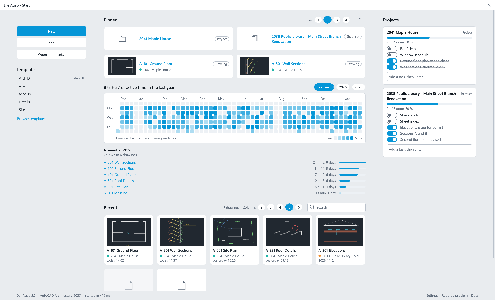
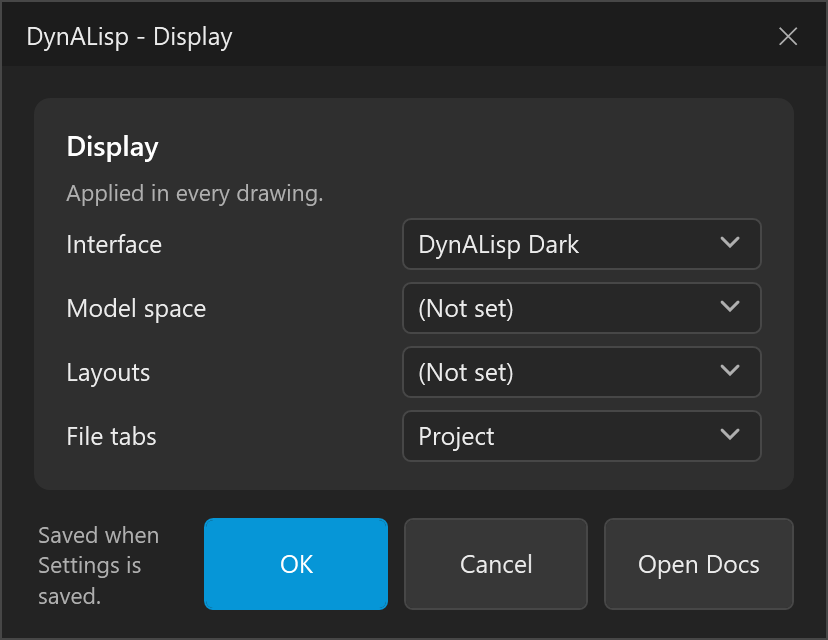
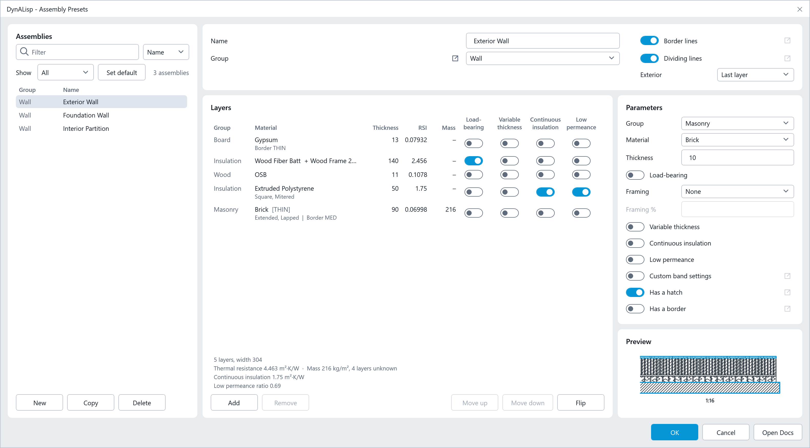
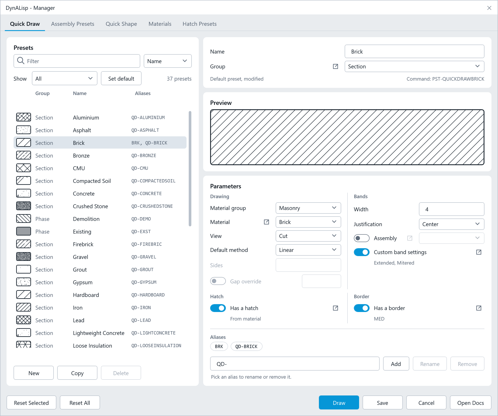
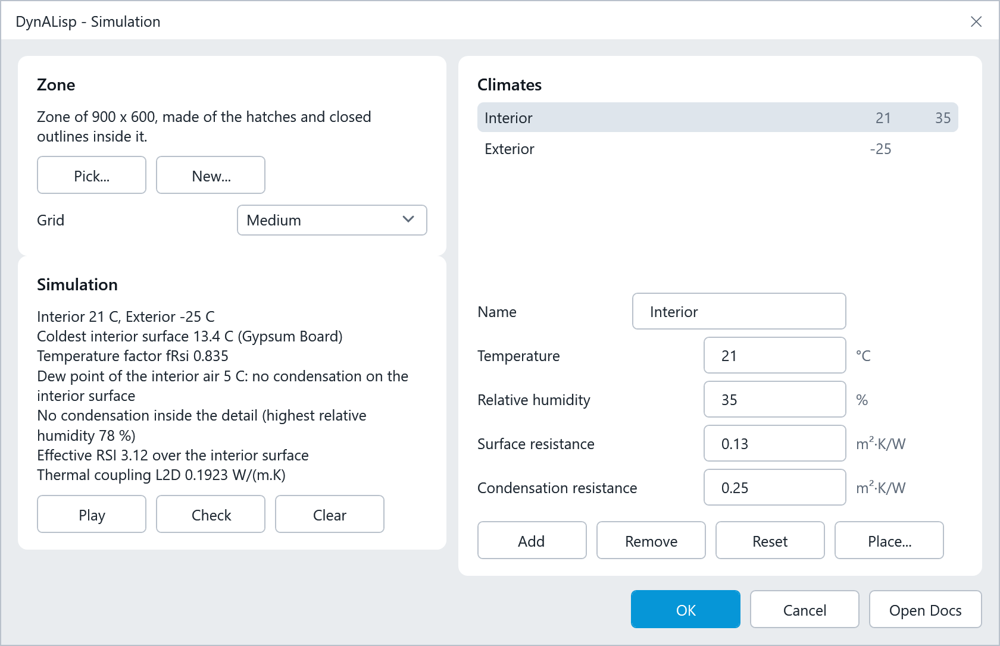
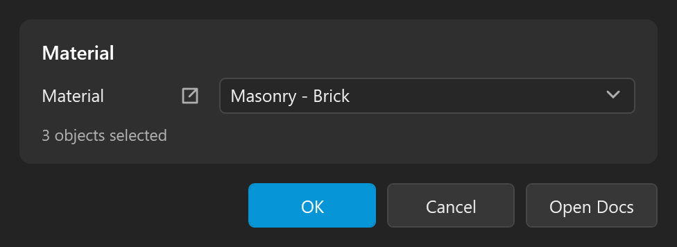
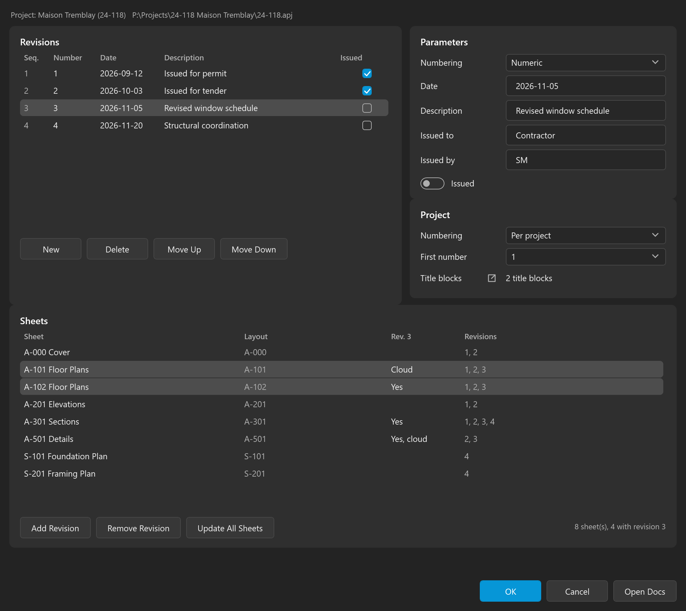
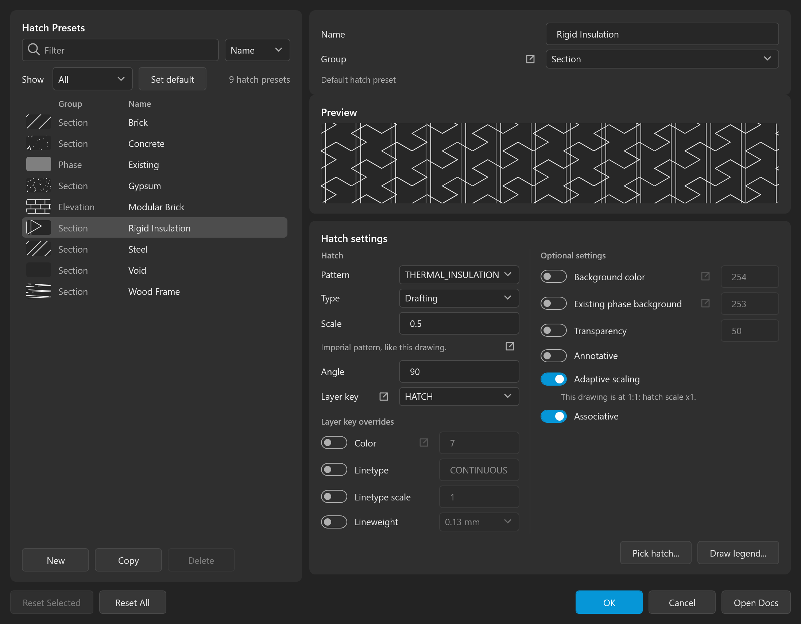
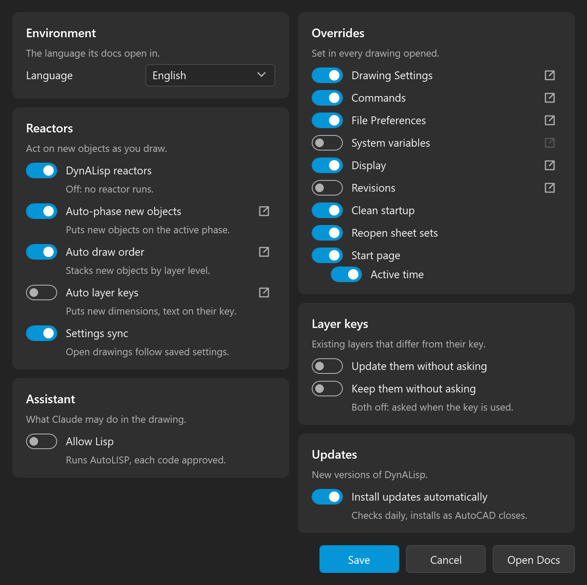

# What's New

What each version of DynALisp brings to the people who draw with it, newest first:
Dyl-Info shows it in its What's New window before an update, once after it, and on
its What's new button; the setup's release shows it as its notes. It speaks to users
only: what they can do now and where to find it, never how the code changed (the
history of the code is in git). CHANGELOG.fr.md is the same in French.

Each version is a `## <version> - <date>` heading (the AppVersion of
PackageContents.xml); `## Next` holds what is merged and not released yet (a git clone
shows it). Each change is a `### <title>` heading, then a few lines of text (a line
starting with `- ` is a bullet), and at most one picture `` and one link to
its docs page `[Open the docs](<path>)`, each on its own line. A path is from the root
of this repository (`Contents/Modules/Dynalisp/Docs/Core/Dyl-Settings.htm#display`):
DynALisp opens the page on the docs website, in its language, and shows the picture
from the website when this computer does not have it. Plain ASCII.

## Next

### A Start page of your own
Dyl-Settings > Overrides > Start page shows the page of DynALisp in the Start tab: New, Open and your templates on the left; your pinned drawings, sheet sets and projects, the time spent in each drawing day by day, and your recent drawings in the middle; the tasks of each project on the right. Click a drawing to see its days, double-click it to open it. Right-click a drawing to show a picture of your choice, or an area of it made again at each save. Report a problem opens an issue with the diagnostics already in it.

[Open the docs](Contents/Modules/Dynalisp/Docs/Core/Dyl-StartPage.htm)

### Dark interface in the DynALisp colors
Dyl-Settings > Display > Interface colors the whole of AutoCAD in its dark theme to match the DynALisp windows: the ribbon, the palettes, Properties, the status bar, the file tabs, the title bar and the Start tab. DynALisp Neutral is the same in a neutral grey, darker. The model space, the paper of the layouts and the background around it follow, or keep a color of their own. An experiment that Autodesk does not support.

[Open the docs](Contents/Modules/Dynalisp/Docs/Core/Dyl-Settings.htm#display)

### A color for each project on the file tabs
Dyl-Settings > Display > File tabs puts a thin bar of color on the file tab of each drawing, the same color for every drawing of a project (the Project Navigator project, or the sheet set), so the drawings of each project are found at a glance.
[Open the docs](Contents/Modules/Dynalisp/Docs/Core/Dyl-Settings.htm#display)

### Your sheet sets open again at each start
AutoCAD forgets the sheet sets of the Sheet Set Manager when it closes. With Reopen sheet sets on (Dyl-Settings > Overrides), DynALisp opens them again each time AutoCAD starts, until you close them in the manager.
[Open the docs](Contents/Modules/Dynalisp/Docs/Plugins/SheetSets.htm)

### Assemblies of the code listed once, with their variants
In the Assembly Presets window, the assemblies that differ only by their boards, their insulation or their spacing are listed once (B6), and their variants (B6a to B6e) are picked in the Variant list of the Layers box.

[Open the docs](Contents/Modules/Dynalisp/Docs/Draw/Dyl-AssemblyPresets.htm)

### A faster Manager
The tabs of the Manager open in about half a second, Assembly Presets included, and no longer flicker when you change tab.
[Open the docs](Contents/Modules/Dynalisp/Docs/Draw/Dyl-Manager.htm)

### Record a bug that comes and goes
DIAG-RECORD records in the background what AutoCAD and DynALisp do, for a bug too rare to catch at once (a zoom that jumps, a pan that sticks). A red REC badge shows it is on: click Bug now each time you feel it, then Stop, and the file of the recording opens, ready to attach to a report.
[Open the docs](Contents/Modules/Dynalisp/Docs/Troubleshooting/Dyl-Diagnostics.htm#sending)

### What's New for you
This window now shows what each version brings you, with pictures and a link to the docs of each change.
[Open the docs](Contents/Modules/Dynalisp/Docs/Core/Dyl-Info.htm#updates)

## 2.0 - 2026-11-25

### DynALisp 2.0 for AutoCAD 2025 and later
DynALisp 2.0 runs in AutoCAD 2025, 2026 and 2027. For AutoCAD 2015 to 2024, keep DynALisp 1.2: it still gets fixes, and its setup is on the releases page. The setup of 2.0 says so when it finds no AutoCAD 2025 or later.
[Open the docs](Contents/Modules/Dynalisp/Docs/Core/Dyl-Info.htm#updates)

## 1.2 - 2026-11-25

### The Manager: every preset window in one
Quick Draw, Assembly Presets, Quick Shape, Materials and Hatch Presets are the tabs of one window: go from a preset to its assembly, its material and its hatch in one click. It stays open while you draw.

[Open the docs](Contents/Modules/Dynalisp/Docs/Draw/Dyl-Manager.htm)

### Simulation of a 2D detail
Dyl-Simulation finds the heat flow, the vapour, the risk of condensation and the monthly moisture balance of a detail drawn with materials, by the methods of ISO 10211, 6946 and 13788.

[Open the docs](Contents/Modules/Dynalisp/Docs/Analysis/Dyl-Simulation.htm)

### Ask Claude about your drawing
The Assistant (Dyl-Assistant) answers questions about the drawing and changes it once you approve. Text Fix corrects the text of a drawing through Claude Code. Off until you turn it on.
[Open the docs](Contents/Modules/Dynalisp/Docs/Utilities/Dyl-Assistant.htm)

### Materials on your objects
Assign a material to the objects you draw, match it from one object to another and show what each object is made of. The assemblies of the building code come with their fire and sound ratings.

[Open the docs](Contents/Modules/Dynalisp/Docs/Draw/Dyl-MaterialAssign.htm)

### Windows that fit your screen
Every DynALisp window fits the screen, can be resized and opens again where you left it. The Hatch Presets window is new, its Drafting previews always at 1:1.
[Open the docs](Contents/Modules/Dynalisp/Docs/Draw/Dyl-HatchPresets.htm)

### Faster drawings
A drawing opens with DynALisp in about 0.4 s.

### Fixes
- SAVE and SAVEAS could say Unknown command.
- Make Layers and Batch Insert work again.

## 1.1 - 2026-11-20

### Docs on the web, in English and French
Every Open Docs button opens the docs website, in the language chosen in Dyl-Settings > Environment: a User Guide for each tool, and Developer docs for whoever changes DynALisp.
[Open the docs](Contents/Modules/Dynalisp/Docs/index.htm)

### Works in any language of AutoCAD
DynALisp works in a French (or any other) AutoCAD. The ribbon is in the language of your AutoCAD.

### Revisions of a project
The revisions of a Project Navigator project and of its sheets, shared by the whole team.

[Open the docs](Contents/Modules/Dynalisp/Docs/Output/Dyl-Revisions.htm)

### Hatch Presets and Preset Groups
Hatch Presets (formerly Materials), groups shared by every preset tool, and the layers of an assembly. Pick hatch... rebuilds a missing pattern from a hatch of the drawing.

[Open the docs](Contents/Modules/Dynalisp/Docs/Draw/Dyl-HatchPresets.htm)

### Ribbon drop-downs and a clean command line
Auto-phase, Phase and the levels of Layer Transfer are picked on the ribbon. Clean startup (Dyl-Settings > Overrides) keeps only the useful lines on the command line once AutoCAD has started.
[Open the docs](Contents/Modules/Dynalisp/Docs/Plugins/Ribbon.htm)

### A report to send when something goes wrong
Dyl-Diagnostics writes a report of your setup, your settings and the drawing, to send in an issue.
[Open the docs](Contents/Modules/Dynalisp/Docs/Troubleshooting/Dyl-Diagnostics.htm)

### Fixes
- AutoCAD Architecture froze on the first drawing with auto-phase on.
- Quick Draw Gallery lists every group, also the empty ones.
- New words in the French dictionary.

## 1.0 - 2026-11-09

### The first release
About 40 DynALisp tools and over 100 tools by Lee Mac, each with its docs page, installed with DynALisp-Setup-1.0.exe.
- Dyl-Suite: turn each command on or off, edit its aliases, open its docs.
- Dyl-Settings: reactors, drawing settings, commands, file preferences, system variables, display.
- Dyl-UserFiles: your edits kept by every update; Export and Import settings to move them.
- Dyl-Info: checks for new versions, shows what changed, installs the update when AutoCAD closes.

[Open the docs](Contents/Modules/Dynalisp/Docs/Core/Dyl-Info.htm)
